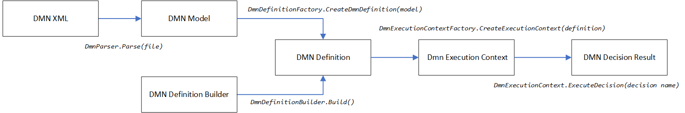

# ScratchyDisk.DmnEngine

A .NET rule engine that executes decisions defined in [DMN (Decision Model and Notation)](https://www.omg.org/spec/DMN/) models. It evaluates decision tables, expression decisions, boxed expressions, business knowledge models and decision services from OMG-standard DMN XML files (versions 1.1, 1.3, 1.3ext, 1.4, 1.5 and 1.6), or from definitions built programmatically using a fluent API. Expressions are evaluated using a full [FEEL](https://www.omg.org/spec/DMN/) (Friendly Enough Expression Language) interpreter built on ANTLR4.

**NuGet package ID:** `ScratchyDisk.DmnEngine`
**Target framework:** .NET 10.0
**Licence:** MIT

See the latest changes in the [changelog](changelog.md).

## Features

- **Full FEEL evaluator** — ANTLR4-based lexer, parser, and tree-walking interpreter supporting the complete FEEL expression language, including `if`/`then`/`else`, `for`/`in`/`return`, `some`/`every` quantifiers, list/context operations, ranges, and ~80 built-in functions
- **DMN 1.1 through 1.6** — auto-detects the DMN version from the XML namespace
- **FEEL 1.6 additions** — descendant expressions, temporal `.value`, single-parameter rounding, zoned date-time construction and numeric literal forms
- **DMN 1.6 error handling** — lenient diagnostics by default, with an opt-in strict mode
- **Decision tables** with all standard hit policies (Unique, First, Priority, Any, Collect, RuleOrder, OutputOrder)
- **Expression decisions** — single FEEL expression producing an output
- **Boxed decision logic** — decision and business knowledge model bodies may be a context, relation, list, invocation, conditional, `for`, `some`, `every`, filter, nested function definition or nested decision table
- **Business knowledge models and decision services** — reusable FEEL functions and multi-output services, invokable from expressions by position or by name
- **DMN imports and model sets** — `DmnModelSet` indexes a folder by namespace so imports resolve across files
- **Declared type conformance** — decision, table, business knowledge model and decision service results are checked against their declared FEEL types; non-conforming results are DMN errors, not silent coercions
- **FEEL functions as values** — functions can be returned, passed as arguments and invoked again (curried lambdas)
- **Decision requirement graphs (DRDs)** — complex models with dependent decisions resolved automatically
- **Fluent builder API** — create decision definitions programmatically without XML
- **CLR interop** — call .NET instance and static methods from FEEL expressions for backward compatibility
- **Expression caching** — parsed AST nodes cached at configurable scope (Execution, Context, Definition, Global)
- **Thread-safe definitions** — definitions are immutable after creation, safe for concurrent execution contexts
- **Web-based testbed** — interactive test lab with regression test suite management
- **CLI tool** — `dmnrunner` for smoke-testing DMN files from the command line or CSV inputs

## DMN and FEEL support

| Area | Status |
|---|---|
| DMN 1.1, 1.3, 1.3ext, 1.4, 1.5, 1.6 model namespaces and parsing | Supported, with auto-detection |
| FEEL 1.6 descendant expressions, `.value`, rounding overloads, zoned date-time, numeric literals, decimal-to-integer conversion | Supported |
| DMN 1.6 lenient/strict error handling | Supported |
| FEEL 1.5 gap closure (list replace, range, overlaps before/after, temporal and range properties, IANA timezones) | Supported |
| Business knowledge models and decision services | Supported, including direct invocation |
| Boxed decision logic (context, relation, list, invocation, conditional, `for`, `some`, `every`, filter, function definitions, nested decision tables) | Supported |
| DMN imports and multi-model folders (`DmnModelSet`) | Supported |
| Declared FEEL type conformance at decision, parameter and result boundaries | Supported |
| OMG DMN TCK (pinned snapshot, committed baseline) | 3,419 of 3,437 cases; remaining 18 need external Java classes |
| B-FEEL dialect | Detection and fail-fast only; full chapter 11 semantics deferred |
| ONNX external functions | Deferred (optional for Level 3 conformance) |

Canonical references:

- [DMN 1.6 specification](https://www.omg.org/spec/DMN/1.6) (`formal/25-12-02`)
- [DMN 1.6 XSD](https://www.omg.org/spec/DMN/20240513/DMN16.xsd)
- [DMN 1.5 specification](https://www.omg.org/spec/DMN/1.5)
- [DMN 1.4 specification](https://www.omg.org/spec/DMN/1.4)
- [B-FEEL language URI](https://www.omg.org/spec/DMN/20240513/B-FEEL/)
- [Conformance test policy](docs/conformance-test-policy.md)

B-FEEL models are rejected with a clear unsupported-language error rather than being silently evaluated as FEEL. ONNX is optional for DMN 1.6 Level 3 conformance and is not implemented.

## Testing and conformance

The engine is developed test-first against the OMG specifications:

1. Write a failing conformance test derived from a clause, table, grammar rule or official example.
2. Confirm the failure is for the expected reason.
3. Implement only enough to pass the test.
4. Refactor with the full regression suite green.

Every conformance test records its canonical source in its name or metadata, for example `Dmn16_10_3_1_2_Rule68_DescendantExpression` or `Dmn15_10_3_4_4_ListReplace_Positional`. `ConformanceManifest` maps each conformance test class to its source, and `ConformanceTraceabilityTests` fails when a source is missing.

The canonical sources are:

- [DMN 1.6 specification](https://www.omg.org/spec/DMN/1.6) (`formal/25-12-02`)
- [DMN 1.6 XSD](https://www.omg.org/spec/DMN/20240513/DMN16.xsd)
- [DMN 1.5 specification](https://www.omg.org/spec/DMN/1.5)
- [DMN 1.4 specification](https://www.omg.org/spec/DMN/1.4)
- [B-FEEL language URI](https://www.omg.org/spec/DMN/20240513/B-FEEL/)

The full policy and required evidence are in [docs/conformance-test-policy.md](docs/conformance-test-policy.md). Security reporting and the threat model are in [SECURITY.md](SECURITY.md). CI runs the DMN 1.5/1.6 conformance subset and then the full regression suite via `.github/workflows/conformance.yml`.

### OMG DMN TCK

The [OMG DMN Technology Compatibility Kit](https://github.com/dmn-tck/tck) is the external conformance measure. The repository carries a local runner (`ScratchyDisk.DmnEngine.Tck`) and a committed ratchet baseline:

```bash
./scripts/fetch-tck.sh
dotnet run --project ScratchyDisk.DmnEngine.Tck -- --tck artifacts/tck/TestCases --baseline docs/tck-baseline.json
```

The current result is 3,419 of 3,437 cases, with level 2 fully cleared. Every case that reaches a decision produces the expected value or the expected error; the 18 remaining cases invoke Java classes shipped with the TCK and cannot run on .NET, so they are reported as unsupported rather than passed. See [docs/tck.md](docs/tck.md) for the result vocabulary, comparison rules and baseline workflow.

## Quick Start

```csharp
var def = DmnParser.Parse(fileName);
var ctx = DmnExecutionContextFactory.CreateExecutionContext(def);
ctx.WithInputParameter("input name", inputValue);
var result = ctx.ExecuteDecision("decision name");
```

For a folder of DMN files with namespace-resolved imports, use a model set:

```csharp
var models = DmnModelSet.LoadDirectory("models");
var def = models.CreateDefinition("https://example.org/orders");
```

See [Model sets and metadata-driven loading](docs/model-sets.md) for folder conventions, import behaviour and the full API.



## Tools

- **[DMN Testbed](docs/testbed.md)** — A web-based test lab for interactively executing decisions, testing full DRD trees, and managing regression test suites. Start it with `dotnet run --project ScratchyDisk.DmnEngine.Testbed -- --dmn-dir=/path/to/dmn/files` and open `http://localhost:5000`.
- **[CLI Tool](ScratchyDisk.DmnEngine.Cli/README.md)** — `dmnrunner` for smoke-testing DMN files from the command line or CSV inputs.
- **[TCK Runner](docs/tck.md)** — `ScratchyDisk.DmnEngine.Tck` runs the OMG DMN TCK and compares results against the committed baseline.

## Architecture

### Core Pipeline

```
DMN XML --> DmnParser --> DmnModel --> DmnDefinitionFactory --> DmnDefinition --> DmnExecutionContextFactory --> DmnExecutionContext
                                                                                                                    |
Code --> DmnDefinitionBuilder --> DmnDefinition ------------------------------------------------------------------>-+
```

1. **Parsing** (`parser/`): `DmnParser` deserialises DMN XML (v1.1, 1.3, 1.3ext, 1.4, 1.5, 1.6) into `DmnModel` DTOs. Supports auto-detection of DMN version from the XML namespace.
2. **Definition** (`engine/definition/`): `DmnDefinitionFactory` transforms `DmnModel` into `DmnDefinition` — validation, variable type resolution, declared-type conformance, and dependency tree construction. `ModelImportResolver` flattens imported models, and `DmnModelSet` indexes a folder of models by namespace so imports resolve without hard-coded paths. Definitions are "virtually immutable" (exposed via read-only interfaces).
3. **Builder** (`engine/definition/builder/`): `DmnDefinitionBuilder` provides a fluent API to create `DmnDefinition` programmatically without XML.
4. **Decisions** (`engine/decisions/`): Three types — `DmnExpressionDecision` (single expression to output), `DmnDecisionTable` (rules with inputs, outputs, hit policies) and `DmnBoxedExpressionDecision` (a context, relation, list, invocation, conditional, iteration or nested table body). Business knowledge models and decision services are executable FEEL functions over these decisions.
5. **Execution** (`engine/execution/`): `DmnExecutionContext` manages variables, resolves decision dependencies recursively, evaluates expressions via the FEEL evaluator, and returns `DmnDecisionResult`.

### FEEL Evaluator Pipeline

```
FEEL expression string
  --> FeelLexer.g4 --> Token stream
  --> FeelNameResolver --> Merged tokens (multi-word names resolved)
  --> FeelParser.g4 --> Parse tree
  --> FeelAstBuilder --> FeelAstNode (AST)
  --> FeelEvaluator --> Result value
```

- **Grammar** (`feel/grammar/`): `FeelLexer.g4` and `FeelParser.g4` — ANTLR4 grammars compiled at build time via `Antlr4BuildTasks`
- **Parsing** (`feel/parsing/`): `FeelScope` (variable/function name registry), `FeelNameResolver` (multi-word identifier merging), `FeelAstBuilder` (parse tree to AST)
- **AST** (`feel/ast/`): `FeelAstNode` hierarchy — literals, operators, control flow, collections, functions, unary tests
- **Evaluation** (`feel/eval/`): `FeelEvaluationContext` (variable scope chain) and `FeelEvaluator` (tree-walking interpreter with three-valued logic)
- **Functions** (`feel/functions/`): ~80 built-in FEEL functions (string, numeric, list, date/time, context, range, boolean, conversion)
- **Types** (`feel/types/`): `FeelTime`, `FeelYmDuration`, `FeelRange`, `FeelContext`, `FeelFunction`, `FeelTypeCoercion`, `FeelValueComparer`
- **Facade** (`feel/FeelEngine.cs`): Public API — `EvaluateExpression()`, `EvaluateSimpleUnaryTests()`, `ParseExpression()`, `ParseSimpleUnaryTests()`

### FEEL Type Mappings

| FEEL Type | .NET Type |
|-----------|-----------|
| `number` | `decimal` |
| `string` | `string` |
| `boolean` | `bool` |
| `date` | `DateOnly` |
| `time` | `FeelTime` |
| `date and time` | `DateTimeOffset` |
| `years and months duration` | `FeelYmDuration` |
| `days and time duration` | `TimeSpan` |
| `list` | `List<object>` |
| `context` | `FeelContext` |
| `range` | `FeelRange` |
| `function` | `FeelFunction` |

### Key Design Patterns

- **Virtual immutability**: Definitions are effectively immutable after creation (hidden behind read-only interfaces like `IDmnVariable`, `IDmnDefinition`). Safe for concurrent access.
- **Factory pattern**: `DmnDefinitionFactory` and `DmnExecutionContextFactory` are the primary creation points. `DmnDefinitionFactory` has virtual protected methods for subclassing.
- **Expression caching**: Parsed FEEL AST nodes (`FeelAstNode`) are cached with configurable scope (None, Execution, Context, Definition, Global) via `ParsedExpressionCacheScopeEnum`. AST nodes are immutable and thread-safe.
- **CLR interop**: The FEEL evaluator supports CLR instance method calls (e.g. `.ToString()`) and static method calls (e.g. `double.Parse()`, `Math.Abs()`) for backward compatibility.

### Decision Table Hit Policies

Unique, First, Priority, Any, Collect (with aggregations: List, Sum, Min, Max, Count), RuleOrder, OutputOrder.

### Dependencies

- **Antlr4.Runtime.Standard** 4.13.1 — ANTLR4 runtime for FEEL parser
- **Antlr4BuildTasks** 13.0.0 — Build-time grammar compilation (private asset)
- **NLog** 6.2.2 — Logging

## Build and Test

```bash
# Build the solution
dotnet build ScratchyDisk.DmnEngine.sln

# Run all tests (4,400+)
dotnet test ScratchyDisk.DmnEngine.Tests/ScratchyDisk.DmnEngine.Tests.csproj

# Run a single test by name
dotnet test ScratchyDisk.DmnEngine.Tests/ScratchyDisk.DmnEngine.Tests.csproj --filter "FullyQualifiedName~TestMethodName"

# Run the OMG DMN TCK against the committed baseline
dotnet run --project ScratchyDisk.DmnEngine.Tck -- --tck artifacts/tck/TestCases --baseline docs/tck-baseline.json
```

Tests are implemented using [MSTest](https://github.com/microsoft/testfx) with [FluentAssertions](https://fluentassertions.com/). The test code is in a shared project linked into the consolidated test project `ScratchyDisk.DmnEngine.Tests` targeting .NET 10.0.

`DmnTestBase` provides abstraction for running the same tests against different sources (DMN XML 1.1/1.3/1.3ext/1.4/1.5 or builders). Primary test classes inherit from `DmnTestBase` and contain test logic targeting DMN XML 1.1. Derived classes override the `Source` property to reuse the same tests against other DMN versions and builder-based definitions. `DmnBuilderSamples` is generated from DMN XML test models using the builder API.

> **Note:** Adjust the `LogHome` variable in `nlog.config` of the test project as needed.

## DMN Testbed

The testbed is a web-based test lab for interactively executing DMN decisions and managing test suites. It serves a Nuxt SPA frontend from an ASP.NET Core backend that wraps the engine.

```bash
# Start the testbed, pointing it at a directory of .dmn files
dotnet run --project ScratchyDisk.DmnEngine.Testbed -- --dmn-dir=/path/to/dmn/files
```

Then open `http://localhost:5000` in a browser. The `--dmn-dir` argument defaults to the current directory if omitted.

To develop the frontend with hot reload, start the backend and the Nuxt dev server separately:

```bash
# Terminal 1: backend on port 5000
dotnet run --project ScratchyDisk.DmnEngine.Testbed -- --dmn-dir=/path/to/dmn/files

# Terminal 2: frontend dev server (proxies /api to the backend)
cd ScratchyDisk.DmnEngine.Testbed/client
npm install
npm run dev
```

To build the frontend for production (output goes to `wwwroot/` so the backend serves it directly):

```bash
cd ScratchyDisk.DmnEngine.Testbed/client
npm run generate
```

## Documentation

| Document | Description |
|----------|-------------|
| [Model sets](docs/model-sets.md) | Loading a folder of models by namespace, import resolution, metadata rules |
| [DMN TCK baseline](docs/tck.md) | Conformance runner, result vocabulary, comparison rules, ratchet workflow |
| [Conformance test policy](docs/conformance-test-policy.md) | Test-first rule, canonical sources, citation and traceability requirements |
| [Testbed](docs/testbed.md) | Web-based test lab for DMN files |
| [CSV batch testing](docs/csv-batch-testing.md) | Batch API, CSV format, Katalon integration, import/export |
| [CLI Tool](ScratchyDisk.DmnEngine.Cli/README.md) | dmnrunner command-line tool for testing DMN files |

## Acknowledgements

This project originated as a fork of [Common.DMN.Engine](https://github.com/adamecr/Common.DMN.Engine) (v1.1.1) by Radek Adamec. The v2.0 release replaced the expression evaluation engine entirely (DynamicExpresso with a custom ANTLR4-based FEEL interpreter), added DMN 1.4/1.5 support, introduced FEEL-native types, a web-based testbed, a CLI tool, and 4,400+ tests. See the [changelog](changelog.md) for the full list of changes.
